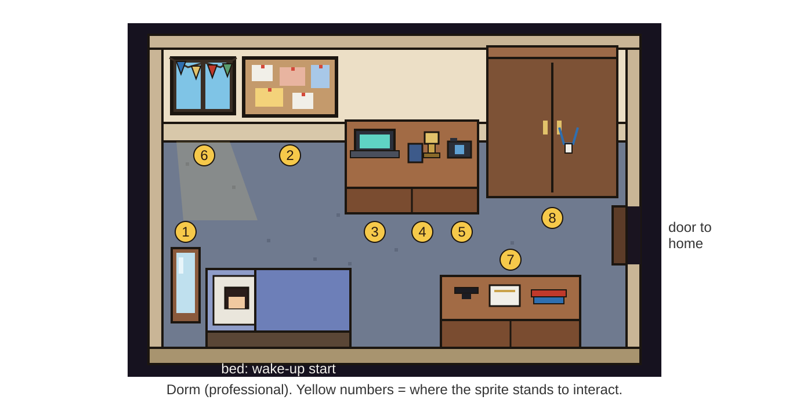
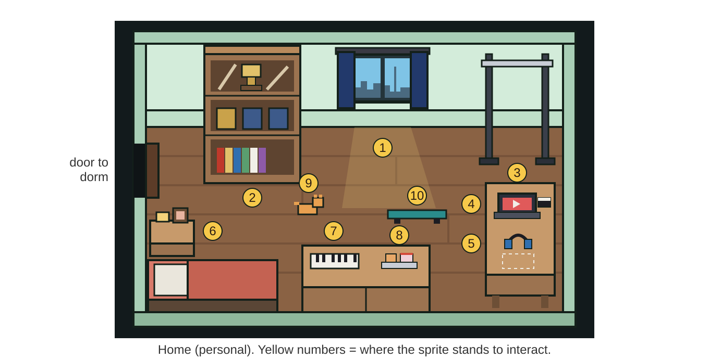

# CLAUDE.md: Daniel Xing's pixel room portfolio (iteration 2)

Read this whole file before writing code. It replaces the iteration 1 version. It is the spec, the design record, and the working agreement for this repo. Images live in `reference/`. Markdown does not render them for you, so open each one with the Read tool when a section points to it.

Start of every session: read this file, open every image in `reference/`, read `TODO_ASSETS.md`, then write a short plan before touching code.

The non game version (formerly `/plain`, becoming `/portfolio`) has its own spec in `PORTFOLIO_VIEW.md`. Build it after iteration 2 is done. Until then, keep `/plain` working and in sync with the item list.

---

## 0. Status and what changed

**Iteration 1 is built and committed.** Both rooms, the wake up sequence, 18 interactables with panels, click to walk, the found counter, `/plain`, mobile controls, and `TODO_ASSETS.md` all work and were verified with Playwright playthroughs. Keep what works. Iteration 1 decisions that stand:
- Phaser 3.90 is pinned (the template now ships Phaser 4; do not upgrade).
- Room layouts are typed files in `src/rooms/*.ts` in tile units, not Tiled maps.
- Assets load by key from `src/assets/manifest.ts`.
- Returning visitors skip the sleep scene; "Start over" in the pause menu resets.
- `reference/soul-knight-lobby-reference.png` stays out of git.

Screenshots of iteration 1 as it looks now: `reference/current-dorm-iteration-1.png` and `reference/current-home-iteration-1.png`. Daniel's written feedback on it: `reference/iteration-2-feedback.pdf`. This file folds all of that feedback in, plus additional design decisions agreed afterwards.

**The four problems iteration 2 solves:**
1. The rooms feel bare, too big, and not cozy.
2. A visitor cannot tell they are in a UCLA dorm, or that the right door leads somewhere.
3. Several objects do not read as what they represent, or hold the wrong content.
4. There is only one way to interact (F). Iteration 2 splits "do something" (E) from "learn more" (F).

---

## 0.2 Iteration 5 changelist (current work)

Iteration 4 (section 0.1) is built. Daniel's notes on it are in `reference/iteration-5-feedback.pdf`; the current state is in `reference/current-dorm-iteration-4.png` and `reference/current-home-iteration-4.png`. Everything below is approved and wins over older sections. Some of it already exists in part (the drinkable fridge, napping in the dorm bed): refine what is there to match this spec rather than rebuilding it. Work through the groups in order, commit and push after each, verify each with Playwright screenshots.

### A. Fix first: the random slow walking
The character sometimes walks very slowly. Find and fix the root cause before touching any speed values, because group B changes speed on purpose and would hide the bug. Likely suspects, check all of them:
- movement scaled by frames instead of elapsed time (delta), so speed drops when the frame rate drops
- the browser throttling a background or unfocused tab, then the game catching up badly
- click to walk pathing and keyboard input fighting over velocity
- the body grinding against small colliders on rugs, clutter, or decor (decor should have tiny or no colliders, section 9.5)
- leftover speed modifiers from sitting, riding, or a mode that did not reset
Add a debug overlay (toggle with backquote, dev builds only) showing current speed, frame rate, and active modifiers. Confirm the fix with a Playwright test that walks a fixed route several times and measures the time taken.

### B. Stats system: Caffeine, Sleep, Creativity
The HUD has three bars. They start fresh on every visit (do not persist across visits).
1. **Starting values:** Caffeine 0/7, Sleep 8/8, Creativity 200/200. Rename Curiosity to Creativity. Creativity never changes. This replaces the randomized stats from iteration 4.
2. **Base speed stays normal.** Do not slow the starting speed: recruiters' first seconds must feel responsive.
3. **Caffeine and the Red Bull:**
   - The dorm mini fridge is a bonus interactable (not one of the 19): E opens it and Daniel drinks a can. A short burst of pixel stars comes off the sprite, Caffeine fills to 7/7 and stays there for the rest of the visit, and walking speed rises by 30%, so the boost is clearly noticeable.
   - Hints: starting about 20 seconds after waking, Daniel says a short line in his speech bubble, then again every 45 to 60 seconds, at most 4 times, and only until he has had the can. Never while a panel or mode is open. Rotate lines such as "where can I get a Red Bull...", "need caffeine", "I swear there's a Red Bull in the fridge". After the first hint, the fridge gets a soft glow until it is used.
   - The can's logo is an image slot (`can-logo`, section 5.4). Until Daniel provides a file, draw a plain blue and silver can.
4. **Sleep:**
   - Sleep drops by 1 every 90 seconds of active play (pause while a panel is open or the tab is hidden).
   - At 2/8 and below, Daniel says a tired line every 45 to 60 seconds, at most 4 times per tired stretch, never while a panel is open: "I'm so tired", "I want to take a nap...", "my bed looks really comfy right now". The nearest bed gets a soft glow.
   - At 0/8, Daniel says "I need to sleep" and, only when the player is idle (no input for about 3 seconds and no panel open), walks to the nearest bed and falls asleep. Any key or click during the walk cancels it and gives control back; he tries again after the next idle stretch.
   - **E on either bed (dorm or home) = sleep.** Lights dim, Zs float up, the window advances in time, a quick wake up, Sleep refills to 8/8. Reuse and tidy the existing dorm nap. The home bed gets the same behavior.
5. All speech bubbles from this system are small, sit just above Daniel's head, and never cover a panel or an item prompt.

### C. HUD and buttons
1. **Top right buttons** (sound, pause, found counter, minimap): twice their current size and clearly more noticeable, still never overlapping the game area. Give them a consistent pixel button style with readable labels.
2. **Bonus counter:** next to the found counter, a small "Secrets X/3" for the three bonus interactables: the fridge, the basketball, the home phone. Bonus items never count toward the 19.
3. **The quick view link must always stay visible.** The room title card currently takes its place at the top center during the first seconds. Move the title card lower, over the top of the room, so "No time to play? Quick view" never disappears.

### D. Dorm room
1. **Binder:** remove the "Consulting stuff" text. It is just a plain binder now (still item 5, Consulting).
2. **Phone (item 6):** show the Instagram logo on its screen using the `instagram-logo` slot (section 5.4).
3. **Door sign:** make "Home, Toronto" on the sign slightly bigger. Remove the separate floating "Home, Toronto →" label that duplicates and covers the sign; if a label is still needed, show it only when Daniel is next to the door. Fix the draw order so Daniel never renders over the sign.
4. **Hope For Hearing shirt:** the printed words slightly bigger.
5. **Floor clutter check:** the clothes, shoes, and bag between the bed and the dresser are getting dense. Make sure every walkway stays at least 1.5 character widths (section 9.5).
6. **Mini basketball hoop (bonus):** on the left wall between the beanbag and the laundry basket. From this camera the side wall is seen edge on, so draw the backboard as a strip on the wall with the rim and net sticking out toward the room. A mini basketball rests on the carpet nearby.
   - **Controls:** E picks up the ball (Daniel holds it). While holding, hold Space to charge a power meter shown next to Daniel, release to shoot. E drops the ball. On touch: tap the ball to pick it up, then press and hold the action button to charge, release to shoot. While holding the ball, Space shoots instead of acting as E; everywhere else Space stays E.
   - **Physics (fake 3D, believable):** the ball has a floor position and a height, with a shadow on the floor that shrinks as the ball rises. Shots follow a gravity arc toward the hoop. The power needed depends on the distance from the hoop: there is a sweet spot window in the meter. Too little power falls short; too much hits the backboard and rebounds; near misses rattle off the rim. The ball bounces off the floor with energy loss (restitution around 0.6), rolls with friction, bounces off walls and furniture footprints, and comes to rest wherever it ends up in the room. If it stops somewhere unreachable or inside a collider, it respawns on the carpet near the hoop.
   - **Feedback:** swish sound and net animation on a make, rim clank on near misses, bounce sounds (only with sound on). A small "3 for 5" style tally near the hoop for the visit. The first make counts the ball as a found secret.
   - Never let the ball land on a door approach tile, and never let it trap the player.

### E. Home room
1. **Shelf books:** the titles "Solo Levelling", "Sweet Home", and "Lookism" are not centered and aligned on their spines. Fix all four: text centered along each spine, rotated correctly for upright, leaning, and lying flat books, and fully readable.
2. **Door sign:** keep the wording "Back to UCLA" and make the text slightly bigger. Same floating label and draw order fixes as the dorm door.
3. **Speaker:** slightly smaller.
4. **Longboard rug:** slightly wider.
5. **Piano black keys:** the playable keyboard gets working black keys. Use the standard computer piano layout: A S D F G H J K for the white keys and W E T Y U for the black keys, plus clicking or tapping any key, with key labels shown on the keys. Keep number keys 1 to 8 as an alternative for white keys.
6. **Home phone (bonus):** a phone on a table with the same `instagram-logo` slot on its screen. E or F opens a small card with his Instagram handle **@dxx_912** and a link to https://www.instagram.com/dxx_912/. Not one of the 19.
7. **Volleyball:** slightly bigger, drawn as a classic volleyball with yellow, black, and orange panels. Any brand logo text goes in the `volleyball-logo` slot, never drawn.
8. **Sleep on the home bed:** E sleeps (section B.4).
9. **Fluffy (the cat):**
   - His name is **Fluffy**. The F prompt reads "F About Fluffy" and the panel title is "About Fluffy". Update `src/content/` and `/portfolio`.
   - Fluffy can jump up onto the home desk, the work table, and the nightstand, walk along them, and knock decor items: nudge them along the surface or push them off so they fall with a small bounce onto the floor. Interactive items never move. Fallen decor must not land on a walkway, a standing spot, or a door approach (pick a nearby free floor spot instead), has no collider, and everything is tidied back to its place when the room is re entered. Keep it occasional, about one knock every minute or two while he is up there.
   - Keep the existing meows, purring, and nap on the bed.

### F. Image slots added in this iteration (add to section 5.4 and `TODO_ASSETS.md`)
| Slot key | File path | Where it appears | Placeholder |
|---|---|---|---|
| `instagram-logo` | `public/assets/decor/instagram-logo.png` | Dorm phone screen and home phone screen | Plain colored rounded square with no symbol |
| `can-logo` | `public/assets/decor/can-logo.png` | Red Bull can from the dorm fridge | Plain blue and silver can |
| `volleyball-logo` | `public/assets/decor/volleyball-logo.png` (optional) | Volleyball on the home shelf | No logo |
Same rules as section 5.4: never draw or trace these logos yourself; render whatever file Daniel provides.

**Definition of done for iteration 5:** the slow walking bug is found, explained in the commit message, and covered by a test; all stats behaviors work exactly as above without ever interrupting a panel; the basketball is fun and never gets stuck; Fluffy's mischief never blocks a path or moves an interactive item; the quick view link is visible from the first frame; three playthroughs still reach 19 of 19; `npm run build` passes; `TODO_ASSETS.md` lists the new slots and the Instagram handle as done.

---

## 0.1 Iteration 4 changelist (done)

Iterations 2 and 3 are built. Daniel reviewed them; his notes are in `reference/iteration-4-feedback.pdf` and the current state is in `reference/current-dorm-iteration-3.png` and `reference/current-home-iteration-3.png`. Everything below is approved. Where it conflicts with older sections of this file, this section wins (those sections have been updated to match where practical). Work through the groups in order, commit and push after each group, verify each with Playwright screenshots.

### A. Audio
1. **Background lofi.** Shuffle every audio file in `public/assets/audio/lofi/` (Daniel drops MP3s there). Quiet and ambient but clearly present (start around 15 to 20% volume). Crossfade between tracks, shuffle without repeats until the list is exhausted, keep playing across the room change. Starts only when the visitor turns sound on (sound stays off by default). Show the current track title small in the pause menu.
2. **Remove the white noise** ambience from the home room. Keep footsteps and object sounds.
3. **Speaker E action** plays the file in `public/assets/audio/featured/` (Daniel will place Rachmaninoff's Piano Concerto No. 2, ending coda in C major, performed by Valentina Lisitsa). E again stops it. While it plays, the speaker bumps to the music, and the lofi ducks to near silence, then fades back after.
4. **Audio ducking everywhere:** lofi ducks while the speaker, the piano overlay, or any panel video plays.
5. **Credits:** record every file in `public/assets/audio/CREDITS.md` with title, artist, source, and license. Mark any file without a license for public use as `PRIVATE ONLY: replace before public launch`, and list those in `TODO_ASSETS.md`. Build must not fail if these folders are empty; the speaker shows "No track loaded yet" in that case.
6. **Speaker F panel** now covers his music taste broadly: dubstep, EDM, classical, R&B, hip hop. Keep the Spotify playlist link(s). Add his lofi playlist link: https://open.spotify.com/playlist/0vvXsWCC9xrXsKd4FyS8kM

### B. Daniel's sprite
1. Lighter skin tone: a light warm East Asian complexion, clearly lighter than now. Check it against `reference/daniel-photos.png` and against the warm room lighting so it does not read as brown in the dim dorm.
2. Eyes: restore the eye style from the iteration 1 sprite (check git history for the earlier placeholder).
3. Neutral mouth: no teeth, no smile. A small closed mouth line.
4. HUD portrait uses the same updated face.

### C. Interactions
1. **Apple crisp pie, E to eat:** Daniel faces the desk, a two second eating animation (fork to mouth, the slice shrinks), then a speech bubble "yum!". The slice is back on the next visit or after the room is re entered. F still opens baking.
2. **Cat sounds:** a random soft meow every 45 to 90 seconds, only when the visitor is in the home room and sound is on; a meow when petted while awake; a purr loop for a few seconds when petted while asleep on the bed. With sound off, show small "meow" and "prrr" text bubbles instead.
3. **Idle thought bubbles:** much smaller and subtler: about half the current size, lower opacity, smaller text, positioned close to Daniel's head, and they fade out sooner.
4. **HUD stats:** Caffeine and Sleep are randomized on every visit (Caffeine 1 to 7 out of 7, Sleep 0 to 6 out of 6, weighted toward low sleep for the joke). Curiosity stays fixed at 200/200.

### D. Dorm room
1. **Top left still feels empty:** make the beanbag noticeably bigger; add a trash bin (with a crumpled paper or two); add a laundry basket with clothes spilling over the top. Also add: a mini fridge with a few magnets, a pair of sneakers near the door (off the approach tile), a small shoe or bag on the floor, and a wall shelf or hooks with a backpack hanging. Keep every walkway and standing spot clear (section 9).
2. **Hope For Hearing shirt:** redraw as a clearly folded T shirt: visible collar, short sleeves folded in, soft fabric shading, small "Hope For Hearing" print. It must not read as paper.
3. **Desk clutter (non interactive):** add a baseball cap, wired earbuds with the cable trailing, a spiral notebook, a few pens, sticky notes, a water bottle. Keep the laptop, binder, and phone clearly readable and their standing spots unchanged.
4. **Door sign arrow:** the arrow on the "Home, Toronto" sign reads as a cross; remove the stray pixel and redraw it as a clean pixel arrow. Check the "Back to UCLA" arrow too.

### E. Home room
1. **Shelf, top tier ("Sports"):** replace the candy cane oar with an oar blade seen face on: a blade shape (straight top edge, angled tip) with blue and white vertical stripes, plus a short bit of handle. Add a beach volleyball. Rename the tier "Sports" in its close up; its panel covers rowing and beach volleyball (he plays beach volleyball in his free time; details and photos `[TODO]`).
2. **Shelf, bottom tier (books):** center the books on the shelf, make them thinner, and vary them: some upright, one or two leaning, one or two lying flat. Spine titles stay readable: "AOT", "Lookism", "Sweet Home", "Solo Levelling".
3. **Longboard rug:** replace the road looking runner with a soft fluffy beige rug (shaggy edge, no dashed center line).
4. **Work table (right wall) looks too tidy:** make it naturally messy. Speaker angled and off center, camera set down casually with its strap draped, plus non interactive clutter: a mug, a notebook, pencils, a small plant, a charging cable, a lens cap, a few receipts or sticky notes. Remove the visible dotted spare slot outline. Keep the speaker and camera standing spots and prompts working.
5. **Bed:** green and blue plaid blanket.
6. **Wall decor:** add two or three empty poster frames on the home walls as image slots (`poster-home-1`, `poster-home-2`, `poster-home-3` at `public/assets/decor/`, original abstract placeholders until Daniel provides files, same rules as section 5.4).

### F. Readability and polish (both rooms)
1. **Arrow overload:** too many bouncing arrows at once. Make unfound arrows smaller, stagger their bob timing, and keep them subtle at a distance; they grow and brighten only when Daniel is near. H still highlights everything.
2. **Camera crop and HUD:** the top of the back wall is cut off and the HUD covers the dorm window and pennant. Show the full back wall, and make the HUD smaller and partly transparent (fully opaque on hover). HUD and minimap must never cover an interactive item.
3. **Fairy light glow:** smaller, warmer glow halos (less white).

### G. Fonts (game panels and the portfolio view)
The current description font looks too corporate. No pixel fonts for body text.
1. Build a temporary page at `/fonts` showing one real panel (Ateball) and one quick view section rendered in three pairings:
   - A (default): Space Mono for labels, nav, subheadings; Nunito for paragraphs.
   - B: Space Grotesk for everything except big headings.
   - C: IBM Plex Mono for labels, nav, subheadings; Nunito for paragraphs.
   Big headings keep Press Start 2P. Paragraphs at 17 to 18px, generous line height.
2. Ship pairing A everywhere (game panels, prompts, quick view, nav) until Daniel picks; make the choice a single token so switching is one line. Self host the fonts.

### H. Quick view
Apply the changes in `PORTFOLIO_VIEW.md` section 10.

**Definition of done for iteration 4:** every item above is visible in fresh Playwright screenshots of both rooms and the quick view; the three playthroughs still reach 19 of 19; `/fonts` exists; `npm run build` passes; `TODO_ASSETS.md` and `CREDITS.md` are updated.

---

## 1. The vision in one paragraph

A personal portfolio that plays like a tiny Soul Knight style game. The visitor loads into a dark room where only a pixel Daniel is visible, asleep. "Press F to wake up." The lights fade up, Daniel hops out of bed and says hi in a speech bubble, a title card reads "Rieber Hall, UCLA", and the visitor is standing in a cozy, slightly messy, clearly UCLA dorm that holds everything professional. A glowing door with a "Home, Toronto" sign leads to his childhood bedroom in North York, which holds everything personal. Every meaningful object can be acted on with E (pet the cat, ride the longboard, do pull ups, sit, play piano) and learned about with F (a pixel panel with real content). The goal is memorability for product management recruiters in the 2027 cycle, without ever making the facts hard to reach.

Priority order when trade offs come up:
1. It works and the content is easy to reach.
2. It feels like Soul Knight: cozy, alive, responsive.
3. It resembles Daniel's real rooms and life. Nice to have, never at the cost of 1 or 2.

---

## 2. How to work in this repo

### Your latitude
| You decide | Fixed by this file (ask before changing) |
|---|---|
| Code architecture, refactors, file layout inside `src/` | Which room holds which item, and the item list (section 7) |
| Tile size, sprite sizes, camera zoom, exact furniture coordinates | Which furniture and decor exist and roughly where (section 6, layout images) |
| Animation timing, easing, particles, lighting implementation | The E and F interaction model (section 8) |
| Panel visual design within the pixel style | The interaction and readability rules (section 9) |
| Placeholder art, original decor art | Content facts: never invent any (section 12) |
| Sound design and sourcing (muted by default) | Third party art policy (section 5.4) |

If something here is impossible or clearly worse in practice, build the closest good version, then tell Daniel what you changed and why. Do not stall on reversible choices.

### Working method
1. Plan first, then build in the order in section 14. Commit at the end of each step with a clear message. Push after each step.
2. Verify visually with the Playwright MCP after every step: screenshot both rooms (asleep, awake, near each item, each panel open), compare against `reference/dorm-layout.png` and `reference/home-layout.png`, and fix overlap, depth sorting, readability, and clutter problems you see. Re-run the three playthroughs (keyboard only, mouse only, touch only) at the end of the iteration.
3. All content goes through `src/content/`. No copy hardcoded in scenes.
4. Every missing asset gets a visible placeholder plus a line in `TODO_ASSETS.md`. Never block on missing photos or art.
5. If an Aseprite MCP is connected (live or batch backend), use it for editing, recoloring, slicing, and exporting sprites. Placeholder and decor art can be drawn in code as now.

---

## 3. Tech stack

Unchanged: Phaser 3.90 + TypeScript + Vite, Arcade Physics, typed room layouts, static build on Vercel, Node 20+. Panels are DOM overlays over the canvas. Optional MCPs: Playwright (verification), Aseprite (sprite work).

---

## 4. Art direction: Soul Knight, specifically

Open `reference/soul-knight-lobby-reference.png`. That is the target camera, scale, lighting, and HUD feel.

- **Camera:** three quarter top down. The back wall is a tall visible face you can hang things on. Side walls are thin strips; the front wall is a thin rim.
- **Characters:** small, chunky, big heads, one pixel dark outline.
- **Rendering:** pixel perfect, integer scaling, no smoothing.
- **Lighting:** a dim room lit by several warm point lights. This is the single biggest lever for "cozy". See section 6.3.
- **Life:** constant small motion: idle bob, screen flicker, dust in light beams, fairy lights twinkling, the cat wandering.
- **Feedback:** squash on interact, hearts and sparkles, small sounds, quick panel pop in.
- **HUD:** Soul Knight puts a character portrait with stat bars top left and a minimap top right. We do the same (section 10).

Soul Knight lobby lessons, still the model: one small hub where you walk up to things and they respond; a second themed zone reached by walking; collections on display; ambient critters and easter eggs. Links for reading only, do not download or embed their images:
- https://www.yekbot.com/soul-knight-living-room-walkthrough/
- https://itemlevel.net/soul-knight-prequel-ocean-lobby-features-easter-eggs-season-1/
- https://itemlevel.net/?p=165437

---

## 5. Assets

### 5.1 Strategy
- Placeholder and decor art drawn in code or with Aseprite, in each room's palette, at final sizes.
- Final art: one itch.io pack (Daniel's choice, pending) plus a commissioned character and cat. Tile and frame sizes come from one config file.
- Every asset loads by a stable key from `src/assets/manifest.ts`. Swapping placeholder for final art means replacing files, not code.
- Keep each pack's license in `public/assets/<pack>/LICENSE`.

### 5.2 The character sprite (Daniel)
Open `reference/daniel-photos.png`. Current placeholder does not look like him. Update it now:
- East Asian young man, warm skin tone, big friendly smile.
- Dark, curly, permed hair: short on the sides with volume and loose curls on top. Shorter than the right hand photo, closer to the left hand one.
- Default outfit: plain white tee (his usual), dark shorts or pants.
- Build the sprite with the shirt on its own layer or palette slot so outfits can be recolored (section 8.4, closet).

Commission list for the artist (update `TODO_ASSETS.md`): idle, walk in four directions, sleep, wake, sit, pet (crouch), ride longboard, pull up, snap photo (optional), with the shirt on a separate layer.

### 5.3 The cat sprite
Open `reference/daniel-photos.png` (right photo). The cat is a fluffy cream and golden longhair with a round face and big green eyes, not an orange tabby. Rebuild the placeholder to match: rounder, fluffier silhouette, cream base with golden shading, green eyes. States: idle, walk, sit, sit with eyes closed (petted), curled up asleep, bat paw. His name and story are TODO.

### 5.4 Third party art: image slots, never recreations
Daniel wants some real world art and brand items in the rooms. The site is private for now. Handle all of these as **image slots**: a frame or surface in the room that renders whatever file Daniel places at the listed path. Do not draw, trace, or approximate any album cover, poster artwork, or brand logo yourself, in code or with Aseprite, even as a placeholder. Until a file exists, render an original placeholder: an abstract pixel design in the listed colors with no text, figures, or logos from the real work.

| Slot key | File path | Where it appears | Placeholder |
|---|---|---|---|
| `poster-graduation` | `public/assets/decor/poster-graduation.png` | Dorm back wall above the desk, P1 | Abstract pink and purple pixel pattern |
| `poster-damn` | `public/assets/decor/poster-damn.png` | Dorm back wall above the desk, P2 | Abstract red and white pixel pattern |
| `poster-duck` | `public/assets/decor/poster-duck.png` | Dorm closet door, P3 | Abstract yellow and white pixel pattern |
| `hoodie-logo` | `public/assets/decor/hoodie-logo.png` | Home wall hook hoodie, chest area | Plain "TORONTO" in a generic pixel font |
| `speaker-logo` | `public/assets/decor/speaker-logo.png` | Home speaker grille badge | Small plain orange badge |
| `phone-screen` | `public/assets/decor/phone-screen.png` | Dorm phone screen (and the phone panel header) | Generic grid of colored squares |
| `poster-home-1`, `poster-home-2`, `poster-home-3` | `public/assets/decor/poster-home-N.png` | Home room walls | Abstract placeholders in the home palette |
| `instagram-logo` | `public/assets/decor/instagram-logo.png` | Dorm and home phone screens | Plain rounded square, no symbol |
| `can-logo` | `public/assets/decor/can-logo.png` | Red Bull can from the dorm fridge | Plain blue and silver can |
| `volleyball-logo` (optional) | `public/assets/decor/volleyball-logo.png` | Home shelf volleyball | No logo |
| `poster-caricature` (optional) | `public/assets/decor/poster-caricature.png` | Dorm wall, optional extra frame | Empty frame, hidden until the file exists |

Slot rules: scale the image down to the slot with nearest neighbour sampling, optionally reduce it to the room palette so it matches the pixel style, keep the frame and lighting consistent, and make slots purely decorative (no glow, no prompt). List every slot in `TODO_ASSETS.md` under "Decor images to provide (optional)".

The UCLA pennant shows the plain text "UCLA" in a simple pixel font with blue and gold colors. Do not reproduce the official UCLA logo or script.

---

## 6. Room specifications

Both rooms shrink in feel, not footprint: the floor gets filled with rugs, furniture, decor, and light so the walkable area is smaller and cozier, while every path and standing spot stays clear (section 9). If the room still reads as too large on screen, reduce the floor by one or two tiles in each direction.

### 6.1 Dorm (professional): "Rieber Hall, UCLA"
Open `reference/dorm-layout.png` (target) and `reference/current-dorm-iteration-1.png` (current).

- **Walls:** light beige, pin friendly. **Floor:** blue grey carpet with speckle texture.
- **Back wall, left to right:**
  - Window showing a sunset view of Royce Hall's two towers (an original silhouette, warm sky). Small succulent on the sill. Light cone onto the floor. Decor only.
  - One big blue and gold UCLA pennant, hung on a dowel (item 2).
  - Cork pin board styled as Daniel's to do list: a "TO DO" header card and sticky notes with checkboxes (item 3).
  - Wall clock showing the visitor's local time (section 10).
  - Two framed poster slots P1 and P2 above the desk (section 5.4). Decor only.
  - Working desk against the back wall (replaces the iteration 1 desk with drawers). Interactive: laptop (item 4), a binder labeled "Consulting stuff" (item 5), phone propped up with the Instagram style screen (item 6). Non interactive clutter: desk lamp, mug, notebook, loose papers, pens, sticky notes, a small plant, a charging cable. LED strip glowing purple under the desk edge.
  - Closet, narrower than before, with poster slot P3 taped to one door and a sleeve hanging out (item 8).
- **Fairy lights** strung along the top of the back wall, twinkling.
- **Top left floor:** a red beanbag you can sit in with E (action only, no panel).
- **Front left:** warm floor lamp, then the bed (spawn). On the bed: a UCLA hoodie (blue with a gold chest stripe), a Bruin bear plush (tan bear). E to sit on the bed.
- **Center:** round soft rug in a muted lilac.
- **Front right:** a bigger dresser holding the grad cap (item 7, high school), a folded white "Hope For Hearing" shirt (item 9), black over ear headphones (decor), a potted plant (decor).
- **Mess:** a small clothes pile and a sock on the floor between the bed and the dresser, kept off paths and standing spots.
- **Right wall:** the door to home, with warm light leaking from under it, a doormat in front, and a small hanging sign "Home, Toronto" with an arrow. It pulses once after the visitor wakes.

### 6.2 Home bedroom (personal): "North York, Toronto"
Open `reference/home-layout.png` (target) and `reference/current-home-iteration-1.png` (current).

- **Walls:** light pastel green. **Floor:** warm wood planks.
- **Back wall, left to right:**
  - Three tier shelf (item 2). Top tier: the trophy moved to the left, a blue and white striped oar to its right; remove the two white sticks. Middle tier: three plaques (keep for now; once Daniel uploads plaque photos, redraw each pixel plaque to resemble its real plaque). Bottom tier: exactly four books standing upright with readable spine text "AOT", "Lookism", "Sweet Home", "Solo Levelling" (book shaped, not binder shaped; plain text titles only, no franchise art).
  - Potted floor plant between the shelf and the window. Decor.
  - Wall clock showing the visitor's local time.
  - Window with dark blue curtains, a Toronto skyline view, and a small plant on the sill (item 1).
  - A hoodie on a wall hook with the `hoodie-logo` slot (section 5.4). Decor.
  - Pull up tower in the top right corner (item 3).
- **Right wall:** work table along the wall, reached from the left. Big black speaker with the `speaker-logo` slot (item 4), camera (item 5), one spare dashed slot. The laptop and the acting item are removed entirely.
- **Front left:** nightstand directly above the bed's pillow end with a lamp that visibly glows (item 6 is the nightstand: family). The photo frame shows a clear placeholder outline of a photo (silhouettes of people) until Daniel's family photo is provided, then a pixelated thumbnail of it. Below it, the bed with two plush toys; E to sit. The cat's nap spot is on this bed.
- **Center:** a rug runner along the open lane where the longboard is parked (item 10) and the cat wanders (item 9).
- **Front middle:** desk and drawers with the digital piano (item 7) and a large apple crisp pie with one slice served on a plate with a fork beside it (item 8), so it reads as baking at a glance.
- **Left wall:** the door back to the dorm with a light leak, a doormat, and a small sign "Back to UCLA" with an arrow.

### 6.3 Cozy interior design rules (apply to both rooms)
- **Layered warm light:** at least three warm light sources per room (lamp, fairy lights or LED strip, window), on top of a slightly dimmed base. Use additive light sprites or a light mask. Avoid one flat bright fill.
- **Texture and softness:** rugs, bedding, plush toys, clothing, beanbag.
- **Plants:** at least three per room at different heights.
- **Personal items in clusters:** group clutter on surfaces and near walls in odd numbered clusters, not scattered evenly.
- **Vertical interest on the back wall:** posters, pennant, clock, lights at varied heights.
- **Palette:** roughly 60% wall and floor base, 30% wood and fabric, 10% saturated accents (UCLA blue and gold in the dorm, Toronto blues and warm wood at home).
- **Messy but readable:** Daniel is messy in real life, so some lived in mess is welcome (clothes, papers, a cable). Mess never sits on a path, a standing spot, or in front of an interactive item, and never competes visually with interactive items.

---

## 7. Interactables (19 total)

Each content item has exactly one standing spot (yellow numbers in the layout images). Keys: **E = action**, **F = learn more (panel)**. Items marked "F only" have no action.

### Dorm (professional), 9 items
| # | Object | E action | F panel content |
|---|---|---|---|
| 1 | HUD portrait (top left of screen, not in the room) | none | **About me.** Headshot, who Daniel is, what he is interested in (growth, tech, startups), short background, links (LinkedIn, email, resume download). Opens by clicking the portrait or pressing I. Counts as found when opened. |
| 2 | Big UCLA pennant | none (F only) | **UCLA education.** Major `[TODO: confirm major]`, Royce Hall photo, courses (advanced micro theory, advanced macro theory, intro to C++, accounting fundamentals), honours student. |
| 3 | "TO DO" pin board | none (F only) | **Student orgs**, shown as a close up of the board where each sticky note is an org with a checked box: William F. Sharpe Fellows (technology vice president), Delta Sigma Pi, the entertainment association (exact name `[TODO]`), International Business for Bruins, UBS Technology Committee, UCLA ResLife. Selecting a note shows a one line description of the org and Daniel's role. |
| 4 | Laptop on the desk | none (F only) | **Software projects.** Tabs: Cold email automator (https://cold-email-automator-two.vercel.app/), Saved posts scroller (https://morning-scroller.vercel.app/), Ateball at Creative Labs (UI screenshots). What, why, role, link. |
| 5 | Binder labeled "Consulting stuff" | none (F only) | **Consulting.** Genesis Alternative Ventures (Project Manager) and the L.E.K. Case Competition win, with slide screenshots. No trophy anywhere. |
| 6 | Phone with an Instagram style screen | none (F only) | **Club marketing.** The panel is styled like a phone feed (original styling, see 5.4 for the screen image slot). Tabs DSP and IBB: description, skills used, measurable results, graphics grid (DSP Vogue campaign), rush video, website build (screenshots plus a link out). |
| 7 | Grad cap on the dresser | none (F only) | **High school only: Upper Canada College IB Diploma.** Hat toss photo, 40/45, 1560 SAT, HL Math A&I, English L&L, Economics; SL Mandarin B, Global Politics, ESS; extended essay on the geopolitical implications of Taiwan's semiconductor industry (link); Business Club President and Asian Heritage Club President with photos. UCLA content moves to item 2. |
| 8 | Closet | **Change outfit**: cycles the character's shirt through a few colors (white, black, UCLA blue, a graphic tee color), with a small wardrobe puff effect. Persist the choice in localStorage. | **Resident Assistant.** Photo, and why: it saves money and it is genuinely fun. |
| 9 | Folded white "Hope For Hearing" shirt on the dresser | none (F only) | **Hope For Hearing.** Milestones and stats, impact, the founding story (meeting Roy on the subway), grants won, what it taught him, and a photo gallery. |
| E only | Beanbag | Sit (character sinks in, small idle animation) | none |
| E only | Dorm bed | Sit on the edge | none |
| | Right door | Walk in to go home | |

### Home (personal), 10 items
| # | Object | E action | F panel content |
|---|---|---|---|
| 1 | Window (Toronto skyline) | none (F only) | **North York.** 18 years there, the same library and cafe through high school, a gallery. |
| 2 | Three tier shelf | none | Shelf close up with three selectable tiers. Top, "Sports": **rowing** (high school varsity, national championship, trophy and oar blade photos) and **beach volleyball** (free time, `[TODO]`). Middle: three **award plaques** (DECA Provincial Champion; FBLA Business Management National Champion at CNLC; FBLA International 6th place at NLC). Bottom: **favorite reads**, Attack on Titan and the webtoons Lookism, Sweet Home, Solo Levelling. |
| 3 | Pull up tower | **Do pull ups**: mash E (or tap) to do reps with a counter and strain animation for a few seconds, then a "nice" pop | **Exercise.** Lifts and sprints or runs almost every day; photos and videos (muscle up, trap bar deadlift, physique). |
| 4 | Big black speaker | **Play featured track**: plays the file in `public/assets/audio/featured/` (Rachmaninoff, Piano Concerto No. 2, coda, Lisitsa), speaker bumps, lofi ducks; E again stops. If master sound is off, show "Sound is off" with a one click "turn on" button. | **Music.** Dubstep, EDM, classical, R&B, hip hop; why he loves them; Spotify playlist links including his lofi playlist. |
| 5 | Camera | **Snap a photo**: white flash, then a polaroid of the current game view slides in, downloadable as a PNG | **Photography.** His love of photography and a gallery of his photos. All content `[TODO]`. |
| 6 | Nightstand (glowing lamp, family photo frame) | none (F only) | **Family.** Parents and sister, and a gallery. |
| 7 | Digital piano | **Play**: opens a one octave playable keyboard (mouse, touch, or number keys 1 to 8) with soft synthesized tones | **Piano.** Twelve years, RCM ARCT Diploma (wording `[TODO]`), recital photos. |
| 8 | Apple crisp pie with a slice on a plate | **Eat**: two second eating animation, then "yum!" |  **Baking and cooking.** Cooks and bakes for his family; food photos and photos of him cooking. |
| 9 | Cat | **Pet**: the cat stops, sits, closes its eyes, hearts float up, and it meows (sound if on, a "meow" text bubble if off). Petting a sleeping cat gives a sleepy purr and a single heart. | **About Fluffy.** Photos, how they got him, his personality. |
| 10 | Longboard | **Ride**: E to hop on, E again to hop off | **Longboard build.** Originally meant to be electric, the build process, soldering photos, the destroyed battery. F works only while not riding. |
| E only | Home bed | Sit on the edge | none |
| | Left door | Walk in to go back to the dorm | |
| | Work table spare slot | reserved, not counted | |

Removed for good: acting (item, laptop, YouTube embed, content, `/plain` section, TODO entries), the dorm mirror, the dorm floor lamp as an item (it is decor now), the multiple pennants, the L.E.K. trophy, the camera in the dorm, the headphones item (black headphones remain as dorm decor), Honour of Kings.

The found counter reads "Found X of 19". Update `/plain` to match this item list and grouping.

---

## 8. Interaction model: E acts, F explains

### 8.1 Keys
- **E** (alias Space) = the object's action. **F** (alias Enter) = open the object's panel. Remove the iteration 1 behavior where E was an alias of F.
- Esc closes panels and exits modes; P or Esc (with nothing open) opens the pause menu; I opens About me; H briefly outlines unfound items.
- The wake up prompt still accepts F, E, Space, Enter, click, and tap.

### 8.2 Prompts
- The prompt above the active object shows only the keys that apply, with verbs: "E Pet  F About him", "E Ride  F The build", "F UCLA". Keep it short and readable, with key caps drawn as small pixel buttons.
- Never show an E prompt on an F only item, or the reverse.

### 8.3 Mouse and touch
- Clicking or tapping an object walks the character to its standing spot. On arrival: if it has only one option, do it. If it has both, show a small two button bubble ("Pet", "About him") at the object. Clicking an E only object performs the action.
- Mobile: two buttons bottom right, labeled with the current verbs (for example "Pet" and "Info"), dimmed when not applicable, plus the joystick and tap to walk.

### 8.4 Modes
- **Sitting** (beanbag, beds): E or any movement stands up. While sitting, the camera eases in slightly and idle thoughts can appear.
- **Riding** (longboard): faster movement with acceleration and coasting, a soft bounce off furniture, no other interactions, E dismounts. The cat bats a paw if the board passes close by.
- **Pull ups:** the input is captured for a few seconds, then control returns.
- **Piano:** keyboard overlay captures input until Esc or a close button.
- **Outfit change:** instant, no mode.

---

## 9. Interaction and readability rules (non negotiable)

1. **One item, one standing spot.** Active only within about one tile and roughly facing it. Nearest wins, with hysteresis.
2. **No stacked choices.** Vertically stacked things (shelf tiers, pin board notes) are one interactable that opens a close up where the visitor picks.
3. **Wall items need floor in front.** Anything on the back wall that is interactive has walkable floor right in front of it. Wall art above furniture is decor or belongs to that furniture.
4. **Surface spacing.** At most three interactive items per surface, at least one character width apart, each with its own standing spot. The work table is reached from its left side.
5. **Walkways.** At least about 1.5 character widths everywhere the player must pass. Collision boxes are floor footprints only. Decor has tiny or no collision unless it is furniture.
6. **Doors stay clear.** No furniture, decor, rug edge collider, or mess overlaps a door or its approach tile.
7. **Depth sorting.** Y sort everything by foot position. Tall objects only against the back wall. The character is never hidden.
8. **Interactive versus decor must be instantly distinguishable.** Interactive items: a clear pulsing outline when nearby and a small bobbing arrow or sparkle when unfound (bigger and higher contrast than the iteration 1 "+" sparkles). Decor: no outline, no sparkle, no prompt, ever. Decor never sits on a standing spot or between the player and an item.
9. **Moving things.** The cat wanders on open floor only, avoids standing spots and doors, can follow the player briefly, pauses near the player, and periodically walks to the home bed nap spot to curl up and sleep for a while. Its standing spot moves with it; when it is on the bed it is petted from the floor beside the bed. It only becomes the active interactable when no static item is nearer.
10. **Panels pause the game.** Esc, click outside, or X closes. Focus returns to the game. Keyboard navigable. Long content scrolls inside the panel.
11. **Click to walk** with grid pathfinding; clicking empty floor walks there.
12. **Never trap the player.** Spawn, door arrivals, dismount points, and stand up points are always free tiles; nudge out of colliders.

---

## 10. Orientation, HUD, and life

- **Wake up speech bubble:** right after the lights come up, Daniel says a short line in a pixel speech bubble, for example "Hey, I'm Daniel. Welcome to my dorm at UCLA." `[TODO: Daniel to confirm the line]`. Dismisses on movement or after a few seconds.
- **Room title cards:** on wake up and on every room entry, a banner fades in and out: "Rieber Hall, UCLA" and "North York, Toronto".
- **HUD portrait, top left (About me, item 1):** Soul Knight style portrait of Daniel's face with three short stat bars in red, grey, and blue. Stats: Caffeine, Sleep, Creativity, with the behavior in section 0.2 B. The portrait pulses gently until first opened. This makes About me the first and most visible thing on screen.
- **Minimap, top right:** two small room boxes joined by a door line, the current room highlighted. Clicking the other room walks the character to the door.
- **Door cues:** light leak under the door, doormat, small sign with an arrow, one pulse after waking. Also mentioned in the controls tooltip on first visit.
- **Clocks:** one wall clock per room showing the visitor's local time (their timezone, from the browser). The window views shift between day, sunset, and night using the visitor's local time.
- **Idle thoughts:** if the player stands still for about 12 seconds, a small thought bubble appears with one of a few lines `[TODO: Daniel to write 5 to 8 lines]`, for example "should probably do my readings". Not while a panel is open.
- **Ambient sound** (only when sound is on): background lofi from `public/assets/audio/lofi/` (section 0.1 A); soft dorm hum in the dorm; no white noise at home; footsteps that differ on carpet and wood. Use royalty free or self made sounds and record their sources and licenses in `public/assets/audio/CREDITS.md`.
- **Camera and screen fill:** the room currently fills only about 60% of the window. Zoom in so the room fills most of the viewport height at an integer scale, or use a gently following camera with room bounds. HUD elements stay pinned to screen corners and never cover interactive items.
- **Completion:** at 19 of 19, a small celebration (confetti, Daniel does a little dance) and a "Thanks for exploring, let's talk" panel with contact links.
- **Easter eggs (keep or add):** Konami code flip; poking a sleeping cat; the cat occasionally pushes something off the desk.

---

## 11. Controls, accessibility, devices

- Move: WASD and arrows. Act: E or Space. Learn more: F or Enter. Close: Esc. Pause: P. About me: I. Hints: H.
- Mobile: joystick, two contextual action buttons, tap to walk. Test portrait and landscape.
- Persistent "Plain version" link to `/plain`, which renders all 19 items from `src/content/`.
- Panels are real HTML, text at least 16px equivalent, WCAG AA contrast, `prefers-reduced-motion` respected (cut shake, particles, long fades, twinkle).
- Audio muted by default, visible toggle. No sound or video autoplays before a user action.

---

## 12. Content system and writing rules

- All content lives in typed files in `src/content/` keyed by item id. Scenes, panels, and `/plain` read from the same files.
- Media in `public/media/<item-id>/`, WebP, at most about 1600px long edge, lazy loaded on panel open.
- **Never invent facts, numbers, names, dates, or quotes.** Missing content gets a marked placeholder like `[TODO: 2 to 3 sentences on why you love photography]` and a line in `TODO_ASSETS.md`.
- Voice: first person, plain, direct, no buzzwords. Never use the long dash character in user facing copy.
- Flag possible overclaiming under "Wording to confirm" in `TODO_ASSETS.md`.

### Open wording items (use placeholders until confirmed)
- Major: the notes say Economics; Daniel has also described a B.A. Business Economics and B.S. Cognitive Science double major.
- The exact official name of the entertainment association.
- ARCT description: replace "highest nonprofessional degree possible in Canada" with the exact credential and a verifiable description.
- Items on his resume not in the content notes (NST internship, LionChase, Bruin Finance Society, Creative Labs project lead, NST summit site, DSP and IBB site rebuilds): keep under "Consider adding" in `TODO_ASSETS.md`. Do not add unasked.

---

## 13. Things to protect while adding all of this

- Load time: keep the game ready in under about 2 seconds on a normal connection. Lazy load panel media, embeds, and the speaker loop.
- Frame rate: lighting and particles must hold 60 fps on a mid range laptop and stay smooth on a phone. Provide a low effects fallback if needed.
- Readability beats decoration every time (rule 9.8). If a screenshot looks busy enough that items are hard to spot, remove decor before adding highlight effects.
- `/plain` stays fast, complete, and current.

---

## 14. Build order for iteration 2 and definition of done

Do these in order, committing and pushing after each, verifying with Playwright screenshots each time.

1. **Interaction model.** Split E and F (section 8), new prompts, two button bubble for click and tap, mobile buttons, I and P keys. Update the counter to 19 and the item registry.
2. **Content remap.** Move content per section 7: pennant gets UCLA, pin board gets orgs, shirt gets Hope For Hearing, grad cap is high school only, binder replaces trophy, phone replaces camera in the dorm, acting removed, camera and speaker added at home, HUD About me. Update `/plain`.
3. **Layout and furniture.** Rebuild both rooms per section 6 and the layout images: working desk, bigger dresser, beanbag, rugs, narrower closet, home work table contents, nightstand, shelf contents, pie, bed plushes, hoodie hook. Re-check every rule in section 9.
4. **Decor and coziness.** Plants, fairy lights, LED strip, lamps, clutter clusters, mess, clocks, the image slots with original placeholders, layered lighting.
5. **Orientation features.** Speech bubble, title cards, door cues, HUD portrait, minimap, camera zoom.
6. **Actions.** Sit, outfit change, pull ups, speaker toggle, camera snap, piano play, cat petting and cat AI including the bed nap, longboard ride.
7. **Sprites.** Updated Daniel placeholder (hair, white tee, recolorable shirt), new cat placeholder.
8. **Life and polish.** Idle thoughts, ambient sound, window time of day, easter eggs, completion.
9. **Final verification.** Three full playthroughs to 19 of 19 (keyboard only, mouse only, touch only on a phone sized screen). Screenshots of every item and panel. `npm run build` with no type errors. Load time check. Update `TODO_ASSETS.md`.

**Done means:** a first time visitor can tell within five seconds that they are in Daniel's UCLA dorm and that there is a second room; every one of the 19 items is reachable and readable with all three input methods; both rooms look full, warm, and cozy without any item being hard to spot; nothing overlaps a door or standing spot; the character and cat are never hidden; all removed items are gone everywhere, including `/plain`.

---

## 15. The gap: what Daniel still needs to provide

Keep this list current in `TODO_ASSETS.md`, grouped by item.

**Art**
- The itch.io pack choice (link and license), which fixes the tile size.
- The commissioned character sheet (section 5.2 list) and cat sheet (section 5.3).
- Optional decor image files for the slots in section 5.4.

**Copy**
- The wake up line, the HUD stat names, and 5 to 8 idle thoughts.
- About me paragraph and tagline.
- Descriptions for every item in section 7, especially the new ones: photography, the TO DO board org one liners, Hope For Hearing.
- The cat's name and story.
- Confirmations from section 12.

**Media**
- Headshot; Royce Hall photo; UCC hat toss and club photos; Ateball screenshots; consulting slides; DSP and IBB graphics, rush videos, website screenshots; Hope For Hearing gallery; RA photo; North York gallery; family photo and gallery; cat photos; rowing, plaque, exercise, recital, food photos; longboard build photos; a gallery of his own photography.
- Links: resume PDF, LinkedIn, email, GitHub, extended essay, Spotify playlist.

**Decisions**
- Custom domain; what fills the spare work table slot; whether to add the "Consider adding" items; final outfit colors for the closet.

---

## 16. Reference files

| File | What it is |
|---|---|
| `reference/dorm-layout.png` / `.svg` | Iteration 2 target layout for the dorm, with HUD, minimap, title card, numbered standing spots, E only spots, poster slots |
| `reference/home-layout.png` / `.svg` | Iteration 2 target layout for the home bedroom |
| `reference/current-dorm-iteration-1.png` | Screenshot of the dorm as built in iteration 1 |
| `reference/current-home-iteration-1.png` | Screenshot of the home bedroom as built in iteration 1 |
| `reference/iteration-2-feedback.pdf` | Daniel's written feedback on iteration 1 |
| `reference/iteration-5-feedback.pdf` | Daniel's written feedback on iteration 4 |
| `reference/current-dorm-iteration-4.png`, `reference/current-home-iteration-4.png` | Screenshots of both rooms after iteration 4 |
| `reference/iteration-4-feedback.pdf` | Daniel's written feedback on iterations 2 and 3 (includes the oar blade reference image) |
| `reference/current-dorm-iteration-3.png`, `reference/current-home-iteration-3.png` | Screenshots of both rooms after iteration 3 |
| `reference/daniel-photos.png` | Photos of Daniel (hair, face, outfit) and his cat, for the sprites |
| `reference/content-outline.pdf` | Daniel's original content outline |
| `reference/dorm-original-sketch.jpg`, `reference/home-original-sketch.jpg` | His rough sketches of the real rooms (context only) |
| `reference/soul-knight-lobby-reference.png` | Soul Knight screenshot from Daniel: camera, scale, lighting, HUD reference. Not in git, never shipped or traced |

The layout images are the source of truth for what exists and roughly where. They are not pixel exact. Adjust sizes and positions as needed to satisfy section 9.
